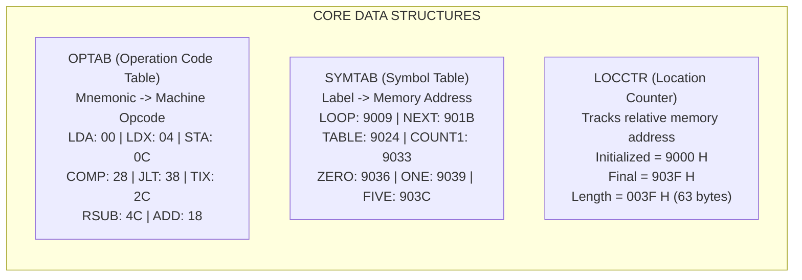
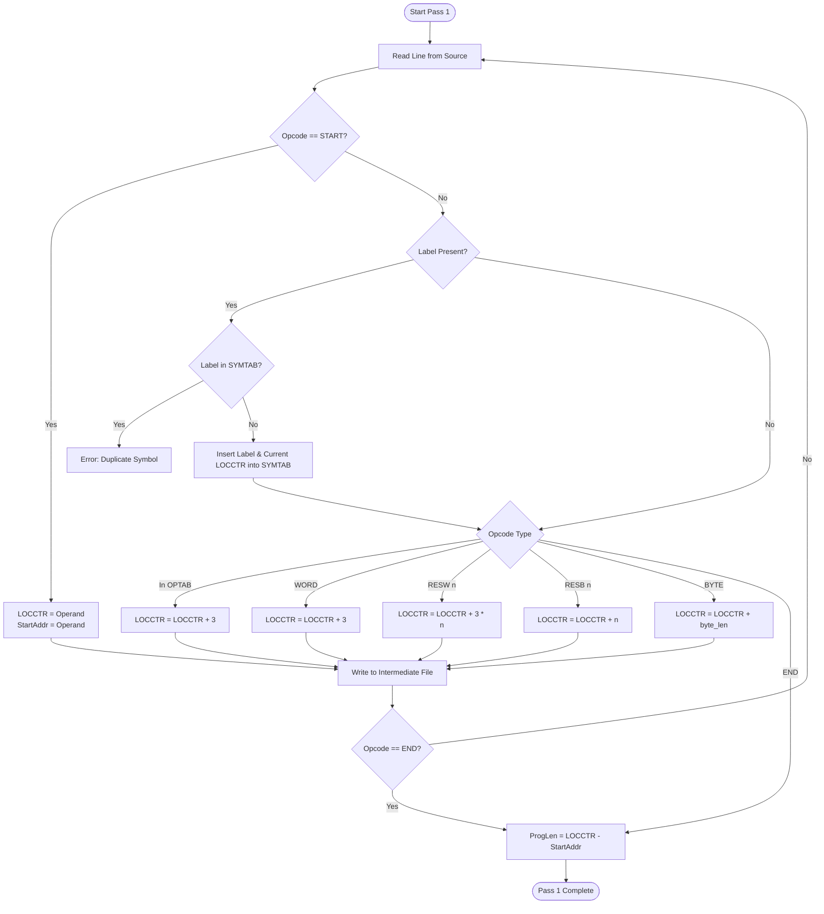

# SSCD (23CS701) ACTIVITY - I: PRESENTATION SLIDE DECK

---

**COURSE:** System Software and Compiler Design (23CS701)  
**SEMESTER / CLASS:** VII Semester 'A' Section  
**ACTIVITY:** Activity - I (Two-Pass Assembler Simulation)  
**PRESENTATION TOPIC:** Simulation of Two-Pass SIC Assembler on Allotted Program (`COUNT`)  
**REFERENCE REPOSITORY:** [DhruvaKumar18/SIC_Simulation](https://github.com/DhruvaKumar18/SIC_Simulation)  

---

## Slide 1: Title Slide

### **DESIGN & SIMULATION OF A TWO-PASS SIC ASSEMBLER**
#### **SSCD (23CS701) — Activity - I**
**Department of Computer Science & Engineering**  
**VII Semester 'A' Section**

* **Batch:** Allotted Batch Activity
* **Program Allotted:** `COUNT START 9000` (Array traversal, condition test, and counting)
* **Core Simulator:** Python-based Two-Pass Assembler (CLI + GUI + Web Interactive)

> **Speaker Note / Presentation Hook:**  
> "Good morning respected faculty and peers. Today, our batch will present the design, architecture, and step-by-step simulation of a Two-Pass Assembler for the Simplified Instructional Computer (SIC) architecture, operating on our allotted assembly program `COUNT`."

---

## Slide 2: Problem Statement & Objectives

### **Activity Objectives**
1. **Analyze the Batch-Allotted SIC Assembly Program:** Understand the logic of the array-scanning and conditional counting code starting at address `9000 H`.
2. **Demonstrate Pass 1:**
   * Track the Location Counter (`LOCCTR`).
   * Resolve label definitions and construct the Symbol Table (`SYMTAB`).
   * Calculate total program length.
3. **Demonstrate Pass 2:**
   * Translate symbolic mnemonics using `OPTAB`.
   * Resolve symbolic target operands using `SYMTAB`.
   * Compute 24-bit two's complement object codes for negative constants (`-5`, `-2`).
4. **Construct Object Program Records:**
   * Format machine code into standard Header (`H`), Text (`T`), and End (`E`) records.
5. **Interactive Simulation:** Execute via Command-Line, Tkinter GUI, and interactive visual interface.

---

## Slide 3: Allotted SIC Assembly Program

```sic
COUNT   START   9000
        LDX     ZERO        ; Initialize X = 0 (Index Register)
        LDA     ZERO        ; Initialize Accumulator A = 0
        STA     COUNT1      ; COUNT1 = 0

LOOP    LDA     TABLE       ; Load element from TABLE
        COMP    ZERO        ; Compare element with 0
        JLT     NEXT        ; If element < 0, skip increment
        LDA     COUNT1      ; Load current count
        ADD     ONE         ; Increment: COUNT1 + 1
        STA     COUNT1      ; Store back to COUNT1

NEXT    TIX     FIVE        ; X = X + 1, Compare X with 5
        JLT     LOOP        ; If X < 5, repeat loop
        RSUB                ; Return from subroutine

TABLE   WORD    10          ; Array element 0: +10
        WORD    -5          ; Array element 1: -5 (Negative)
        WORD    20          ; Array element 2: +20
        WORD    -2          ; Array element 3: -2 (Negative)
        WORD    15          ; Array element 4: +15

COUNT1  RESW    1           ; Reserve 1 word for positive count
ZERO    WORD    0           ; Constant 0
ONE     WORD    1           ; Constant 1
FIVE    WORD    5           ; Loop boundary limit (5)
        END     COUNT       ; End of program, execution starts at COUNT
```

> **Speaker Note:**  
> "Our allotted code processes an array of 5 integers (`10, -5, 20, -2, 15`). It filters out negative numbers and increments `COUNT1` for non-negative items. Notice the presence of negative constants `-5` and `-2`, which require 24-bit two's complement evaluation."

---

## Slide 4: Why a Two-Pass Assembler?

### **The Forward Reference Dilemma**
* An instruction may reference a label that is defined **later** in the source program.
* Example from our program:
  ```sic
  9009    LOOP    LDA    TABLE    ; Where is TABLE? Not yet defined!
  ...
  9024    TABLE   WORD   10       ; TABLE is defined here at 9024!
  ```
* In a single pass, when the assembler reaches line `9009`, it does not know the target address of `TABLE`.

### **The Two-Pass Solution**
* **PASS 1 (Define Symbols & Addresses):** Scans the code, assigns memory addresses via `LOCCTR`, builds `SYMTAB`, and generates intermediate code.
* **PASS 2 (Generate Code):** Re-reads intermediate code, resolves all operands from `SYMTAB`, translates opcodes via `OPTAB`, and emits object code and HTE records.

---

## Slide 5: SIC Machine Architecture Primer

```
                     SIC 24-BIT INSTRUCTION FORMAT
  0              7   8   9                               23
 +----------------+---+-----------------------------------+
 |     Opcode     | x |              Address              |
 +----------------+---+-----------------------------------+
       8 bits     1 bit              15 bits
```

| Component | Specification | Function in our Simulation |
| :--- | :--- | :--- |
| **Word Size** | 24 bits ($3$ bytes) | Every standard instruction and `WORD` is 3 bytes |
| **Registers** | `A` (Accumulator), `X` (Index), `L` (Link), `PC`, `SW` | `A` tests values; `X` tracks loop count |
| **Addressing** | Direct ($x=0$) & Indexed ($x=1$) | Direct memory referencing to `TABLE`, `COUNT1`, etc. |
| **Memory** | $32,768$ Bytes ($2^{15}$) | Program loaded starting at Hex `9000` |
| **Negative Repr.** | 2's Complement ($2^{24} - |V|$) | `-5` and `-2` represented in 24-bit hex words |

---

## Slide 6: Key Assembler Data Structures



* **OPTAB:** Static lookup table used in Pass 1 (to check validity & length) and Pass 2 (to get binary opcode).
* **SYMTAB:** Dynamic hash map / dictionary populated during Pass 1, queried during Pass 2.
* **LOCCTR:** Internal integer register incremented according to instruction/directive length.

---

## Slide 7: Pass 1 Algorithmic Workflow



---

## Slide 8: Pass 1 Simulation Trace (Allotted Code)

| Line | Address (Hex) | Label | Opcode | Operand | LOCCTR Increment Rule | Next LOCCTR |
| :---: | :---: | :---: | :---: | :---: | :--- | :---: |
| **1** | `9000` | `COUNT` | `START` | `9000` | Initialize starting address | `9000` |
| **2** | `9000` | - | `LDX` | `ZERO` | Format 3 instruction ($+3$) | `9003` |
| **3** | `9003` | - | `LDA` | `ZERO` | Format 3 instruction ($+3$) | `9006` |
| **4** | `9006` | - | `STA` | `COUNT1` | Format 3 instruction ($+3$) | `9009` |
| **5** | `9009` | `LOOP` | `LDA` | `TABLE` | Store `LOOP=9009` in SYMTAB; $+3$ | `900C` |
| **6** | `900C` | - | `COMP` | `ZERO` | Format 3 instruction ($+3$) | `900F` |
| **7** | `900F` | - | `JLT` | `NEXT` | Format 3 instruction ($+3$) | `9012` |
| **8** | `9012` | - | `LDA` | `COUNT1` | Format 3 instruction ($+3$) | `9015` |
| **9** | `9015` | - | `ADD` | `ONE` | Format 3 instruction ($+3$) | `9018` |
| **10** | `9018` | - | `STA` | `COUNT1` | Format 3 instruction ($+3$) | `901B` |
| **11** | `901B` | `NEXT` | `TIX` | `FIVE` | Store `NEXT=901B` in SYMTAB; $+3$ | `901E` |
| **12** | `901E` | - | `JLT` | `LOOP` | Format 3 instruction ($+3$) | `9021` |
| **13** | `9021` | - | `RSUB` | - | Format 3 instruction ($+3$) | `9024` |
| **14** | `9024` | `TABLE` | `WORD` | `10` | Store `TABLE=9024` in SYMTAB; $+3$ | `9027` |
| **15** | `9027` | - | `WORD` | `-5` | 1 word integer constant ($+3$) | `902A` |
| **16** | `902A` | - | `WORD` | `20` | 1 word integer constant ($+3$) | `902D` |
| **17** | `902D` | - | `WORD` | `-2` | 1 word integer constant ($+3$) | `9030` |
| **18** | `9030` | - | `WORD` | `15` | 1 word integer constant ($+3$) | `9033` |
| **19** | `9033` | `COUNT1` | `RESW` | `1` | Store `COUNT1=9033`; $+ 3 \times 1 = 3$ | `9036` |
| **20** | `9036` | `ZERO` | `WORD` | `0` | Store `ZERO=9036`; $+3$ | `9039` |
| **21** | `9039` | `ONE` | `WORD` | `1` | Store `ONE=9039`; $+3$ | `903C` |
| **22** | `903C` | `FIVE` | `WORD` | `5` | Store `FIVE=903C`; $+3$ | `903F` |
| **23** | `903F` | - | `END` | `COUNT` | Terminate Pass 1 | `903F` |

---

## Slide 9: Generated Symbol Table (SYMTAB) & Metrics

```
+-------------------------------------------------------------+
|                        SYMBOL TABLE                         |
+----------------------+--------------------+-----------------+
|     SYMBOL NAME      |    HEX ADDRESS     | DECIMAL ADDRESS |
+----------------------+--------------------+-----------------+
|        LOOP          |       9009         |      36873      |
|        NEXT          |       901B         |      36891      |
|        TABLE         |       9024         |      36900      |
|        COUNT1        |       9033         |      36915      |
|        ZERO          |       9036         |      36918      |
|        ONE           |       9039         |      36921      |
|        FIVE          |       903C         |      36924      |
+----------------------+--------------------+-----------------+
```

### **Program Metrics**
* **Starting Address:** `9000 H`
* **Final Address (`LOCCTR` at END):** `903F H`
* **Program Length:** $903F_{16} - 9000_{16} = \mathbf{003F_{16}} = \mathbf{63 \text{ Bytes}}$

> **Speaker Note:**  
> "Notice that `COUNT` is the program name on `START`, while labels `LOOP`, `NEXT`, `TABLE`, `COUNT1`, `ZERO`, `ONE`, and `FIVE` are stored with their exact byte-aligned addresses. No duplicate symbols were detected."

---

## Slide 10: Pass 2 Machine Code Translation

### **Assembly Rules for Pass 2**
1. **Instruction Format 3:**  
   $$\text{Object Code} = \text{Opcode (2 hex digits)} + \text{Operand Address (4 hex digits)}$$
   * Example: `LDX ZERO`
     * `OPTAB['LDX'] = 04`
     * `SYMTAB['ZERO'] = 9036`
     * $\text{Object Code} = \mathbf{049036}$
2. **Subroutine Return (`RSUB`):**
   * No operand $\rightarrow$ padded with zeros: $\mathbf{4C0000}$
3. **Storage Directives (`RESW`, `RESB`):**
   * Produce **NO** object code (`--`). Forces Text Record split!

---

## Slide 11: Two's Complement Math for Negative Constants

Standard SIC integers are strictly **24-bit words** ($6$ hexadecimal digits).

$$\text{2's Complement Hex} = (2^{24} - |V|) = (16,777,216 - |V|)$$

````carousel
### Computation for WORD -5
* Decimal magnitude $|-5| = 5$
* Binary magnitude: `00000000 00000000 00000101`
* 1's Complement: `11111111 11111111 11111010`
* Add 1 (2's Comp): `11111111 11111111 11111011`
* In Hexadecimal: **`FFFFFB`**
* Direct verification: $16,777,216 - 5 = 16,777,211 = \text{FFFFFB}_{16}$
<!-- slide -->
### Computation for WORD -2
* Decimal magnitude $|-2| = 2$
* Binary magnitude: `00000000 00000000 00000010`
* 1's Complement: `11111111 11111111 11111101`
* Add 1 (2's Comp): `11111111 11111111 11111110`
* In Hexadecimal: **`FFFFFE`**
* Direct verification: $16,777,216 - 2 = 16,777,214 = \text{FFFFFE}_{16}$
<!-- slide -->
### Critical Simulator Implementation Fix
```python
# WRONG (Naive string format):
format(-5, "06X")  # Produces '-00005' (Invalid 7-char string!)

# CORRECT (24-bit Two's Complement Mask):
format(-5 & 0xFFFFFF, "06X")  # Produces 'FFFFFB' (Valid 6-hex-digit SIC word)
```
````

---

## Slide 12: Final Assembled Object Code Table

| Address | Source Instruction | Machine Opcode | Operand Address | Final Object Code |
| :---: | :--- | :---: | :---: | :---: |
| `9000` | `COUNT START 9000` | - | - | `--` |
| `9000` | `      LDX   ZERO` | `04` | `9036` | **`049036`** |
| `9003` | `      LDA   ZERO` | `00` | `9036` | **`009036`** |
| `9006` | `      STA   COUNT1`| `0C` | `9033` | **`0C9033`** |
| `9009` | `LOOP  LDA   TABLE` | `00` | `9024` | **`009024`** |
| `900C` | `      COMP  ZERO` | `28` | `9036` | **`289036`** |
| `900F` | `      JLT   NEXT` | `38` | `901B` | **`38901B`** |
| `9012` | `      LDA   COUNT1`| `00` | `9033` | **`009033`** |
| `9015` | `      ADD   ONE` | `18` | `9039` | **`189039`** |
| `9018` | `      STA   COUNT1`| `0C` | `9033` | **`0C9033`** |
| `901B` | `NEXT  TIX   FIVE` | `2C` | `903C` | **`2C903C`** |
| `901E` | `      JLT   LOOP` | `38` | `9009` | **`389009`** |
| `9021` | `      RSUB` | `4C` | `0000` | **`4C0000`** |
| `9024` | `TABLE WORD  10` | - | - | **`00000A`** |
| `9027` | `      WORD  -5` | - | - | **`FFFFFB`** |
| `902A` | `      WORD  20` | - | - | **`000014`** |
| `902D` | `      WORD  -2` | - | - | **`FFFFFE`** |
| `9030` | `      WORD  15` | - | - | **`00000F`** |
| `9033` | `COUNT1 RESW 1` | - | - | `--` |
| `9036` | `ZERO  WORD  0` | - | - | **`000000`** |
| `9039` | `ONE   WORD  1` | - | - | **`000001`** |
| `903C` | `FIVE  WORD  5` | - | - | **`000005`** |
| `903F` | `      END   COUNT` | - | - | `--` |

---

## Slide 13: Generated Object Program (HTE Records)

```
+------------------------------------------------------------------------------------------------+
|                                    HTE OBJECT FILE CONTENT                                     |
+------------------------------------------------------------------------------------------------+
| H^COUNT ^009000^00003F                                                                         |
| T^009000^1E^0490360090360C903300902428903638901B0090331890390C90332C903C                      |
| T^00901E^15^3890094C000000000AFFFFFB000014FFFFFE00000F                                        |
| T^009036^09^000000000001000005                                                                 |
| E^009000                                                                                       |
+------------------------------------------------------------------------------------------------+
```

### **Record Breakdown**
1. **Header Record (`H`):**
   * Name: `COUNT ` (Col 2–7)
   * Start Address: `009000` (Col 8–13)
   * Program Length: `00003F` ($63$ bytes) (Col 14–19)
2. **Text Record 1 (`T`):** Starts at `9000`, length `1E` ($30$ bytes = 10 words, standard max limit).
3. **Text Record 2 (`T`):** Starts at `901E`, length `15` ($21$ bytes = 7 words: `JLT`, `RSUB`, 5 `TABLE` words). Ends because line `9033` is `RESW 1`!
4. **Text Record 3 (`T`):** Resumes at `9036` (after `RESW`), length `09` ($9$ bytes: `ZERO`, `ONE`, `FIVE`).
5. **End Record (`E`):** Transfer execution address `009000` (`COUNT`).

---

## Slide 14: Simulator Implementation & Tooling

```
  +------------------------------------------------------------------+
  |                   MULTI-INTERFACE SIMULATOR                      |
  +------------------------------------------------------------------+
  |  1. Python CLI Driver (main.py)                                  |
  |     - Full console logging of Pass 1, SYMTAB, Pass 2, & HTE      |
  |                                                                  |
  |  2. Desktop Tkinter GUI (gui.py)                                 |
  |     - Interactive step-by-step table highlighting & status bar   |
  |                                                                  |
  |  3. Standalone Generative Web UI (sic_assembler_simulator.html)   |
  |     - Live editable assembly buffer                              |
  |     - Single-step Pass 1 & Pass 2 buttons                        |
  |     - Dedicated 2's complement computation cards                 |
  +------------------------------------------------------------------+
```

* Cloned and enhanced directly from: [https://github.com/DhruvaKumar18/SIC_Simulation](https://github.com/DhruvaKumar18/SIC_Simulation)
* Enhanced with:
  * 24-bit Two's Complement negative number support.
  * Automatic Text Record segmentation across `RESW` reservations.
  * Full HTE loader output formatting.

---

## Slide 15: Viva Voce Defense & Frequently Asked Questions

### **Q1: Why does a standard SIC Text Record have a maximum length of $30$ bytes ($1E_{16}$)?**
> **Answer:** In the classical 80-column punched card standard, 1 column is for 'T', 6 columns for start address, 2 columns for length, leaving 69 columns for object code. Since each byte requires 2 hexadecimal characters, $30 \text{ bytes} \times 2 = 60 \text{ columns}$, which easily fits within the card width.

### **Q2: Why does `RESW 1` break the Text Record?**
> **Answer:** `RESW` reserves uninitialized memory space without generating any machine object bytes. A loader placing contiguous bytes cannot jump over memory addresses without a new starting address; hence, `RESW` terminates the current Text Record and starts a new one at the next defined byte.

### **Q3: How are negative numbers represented in standard SIC `WORD`?**
> **Answer:** Standard SIC memory words are 24 bits ($3$ bytes). Negative integers are stored in 2's complement form ($2^{24} - |V|$). For $-5$, $2^{24} - 5 = 16,777,211 = \text{FFFFFB}_{16}$.

### **Q4: What is the purpose of `OPTAB` vs `SYMTAB`?**
> **Answer:** `OPTAB` is a static language table containing predefined operation mnemonics and opcodes. `SYMTAB` is a dynamic program table created during Pass 1 mapping user-defined labels to assigned memory locations.

---

## Slide 16: Conclusion & Wrap-Up

### **Summary of Results**
* Successfully simulated Pass 1 and Pass 2 of the two-pass assembler for the allotted `COUNT` program.
* Verified `LOCCTR` memory tracking starting at `9000 H`, yielding a total program size of `003F H` ($63$ bytes).
* Correctly resolved all forward references and verified two's complement generation (`FFFFFB` and `FFFFFE`).
* Synthesized standard-compliant Header, Text, and End records.
* Provided complete code, executable simulator, formal report, and presentation deck.

**Thank You! We are now open for Questions.**
