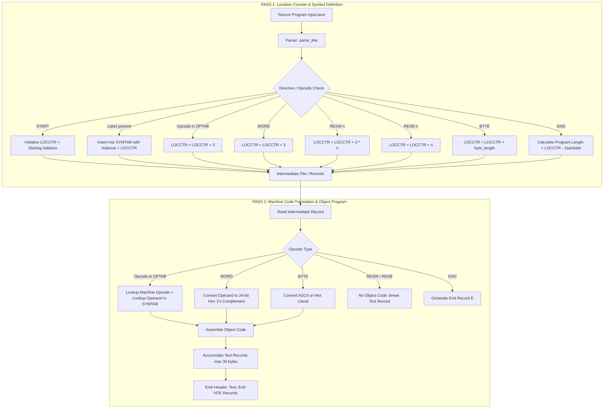

# SSCD (23CS701) ACTIVITY - I: TECHNICAL REPORT

---

**COURSE:** System Software and Compiler Design (23CS701)  
**SEMESTER / SECTION:** VII Semester 'A' Section  
**ACTIVITY:** Activity - I: Two-Pass Assembler Simulation  
**PROJECT TITLE:** Design, Implementation, and Simulation of a Two-Pass Assembler for the Simplified Instructional Computer (SIC)  
**PROGRAM ALLOTTED:** `COUNT START 9000 ... END COUNT` (Positive/Negative Array Processing & Counting)  
**REPOSITORY REFERENCE:** [DhruvaKumar18/SIC_Simulation](https://github.com/DhruvaKumar18/SIC_Simulation)  

---

## Executive Summary

This report documents the architectural design, algorithmic workflow, and detailed execution trace of a **Two-Pass Assembler** for the standard **Simplified Instructional Computer (SIC)** machine model. 

The primary purpose of an assembler is to translate human-readable symbolic assembly language programs into relocatable or executable machine language instructions (Object Code). A single-pass approach is fundamentally incapable of resolving symbolic target addresses that appear in the instruction stream before their definition point—known as the **Forward Reference Problem**. To overcome this, a classic Two-Pass Assembler separates the translation into two distinct phases:
1. **Pass 1:** Defines symbols, assigns relative memory addresses using a Location Counter (`LOCCTR`), builds the Symbol Table (`SYMTAB`), and emits an intermediate representation.
2. **Pass 2:** Translates symbolic mnemonics into binary/hexadecimal machine opcodes, resolves symbolic operand references using `SYMTAB`, generates constants (including 24-bit two's complement representations for negative values), and formats the object program into standard Header, Text, and End (**HTE**) records.

This study simulates the batch-allotted program (`COUNT START 9000`), which traverses an integer table containing positive and negative values, tests each element, and increments a counter. The report details the complete step-by-step memory allocation, symbol table formulation, object code computation, and formatted object file generation.

---

## 1. Simplified Instructional Computer (SIC) Architecture

The Simplified Instructional Computer (SIC) is an educational machine architecture formulated by Leland L. Beck to illustrate the foundational mechanisms of system software without the overwhelming complexity of modern commercial computer systems.

### 1.1 Memory and Word Organization
* **Memory Size:** SIC standard memory consists of $32,768$ ($2^{15}$) bytes, numbered $0$ to $32,767$ (hexadecimal `0000` to `7FFF`).
* **Byte Size:** $8$ bits.
* **Word Size:** $24$ consecutive bits ($3$ contiguous bytes). All standard arithmetic and data transfers operate on 24-bit words.
* **Byte Ordering:** Big-Endian (the most significant byte is stored at the lowest memory address).

### 1.2 Registers
SIC includes five dedicated 24-bit hardware registers:

| Mnemonic | Register Number | Name | Functional Purpose |
| :---: | :---: | :--- | :--- |
| **A** | `0` | Accumulator | Primary register used for all arithmetic, logical, and data transfer instructions. |
| **X** | `1` | Index Register | Used for address calculation in indexed addressing mode ($TA = \text{address} + (X)$). |
| **L** | `2` | Linkage Register | Stores the return address when invoking subroutines via `JSUB`. |
| **PC** | `8` | Program Counter | Holds the memory address of the next instruction to be fetched and executed. |
| **SW** | `9` | Status Word | Contains execution condition flags (e.g., Condition Code: `<`, `=`, `>`). |

### 1.3 Data Formats and Negative Number Representation
* **Integers:** Stored as 24-bit binary numbers. Negative values are strictly represented using **Two's Complement** notation ($2^{24} - |V|$).
* **Characters:** Stored using 8-bit ASCII encoding.
* **Floating-Point:** Not supported in standard SIC (available only in SIC/XE).

### 1.4 Instruction Format and Addressing Modes
Standard SIC uses a single 24-bit (3-byte) instruction format:

```
  0              7   8   9                               23
 +----------------+---+-----------------------------------+
 |     Opcode     | x |              Address              |
 +----------------+---+-----------------------------------+
       8 bits     1 bit              15 bits
```

* **Opcode (Bits 0–7):** 8-bit machine operation code.
* **x-Bit (Bit 8):** Flag indicating Indexed Addressing Mode.
  * $x = 0$: Direct Addressing mode; Target Address $TA = \text{Address}$.
  * $x = 1$: Indexed Addressing mode; Target Address $TA = \text{Address} + (X)$.
* **Address (Bits 9–23):** 15-bit memory address target.

---

## 2. Two-Pass Assembler Architecture and Data Structures



### 2.1 The Forward Reference Problem
Consider the assembly statements:
```sic
LOOP    LDA     TABLE
        ...
TABLE   WORD    10
```
When the assembler first encounters `LDA TABLE` at address `9009`, it cannot generate machine code because the target address of `TABLE` has not yet been declared. The symbol `TABLE` only appears later at address `9024`. This structural dilemma necessitates a two-pass design.

### 2.2 Core Internal Data Structures

#### 1. Operation Code Table (`OPTAB`)
A static lookup dictionary containing all predefined SIC mnemonics, machine opcodes, and instruction lengths.

| Mnemonic | Hex Opcode | Length (Bytes) | Description |
| :---: | :---: | :---: | :--- |
| `LDA` | `00` | 3 | Load Accumulator with memory word |
| `LDX` | `04` | 3 | Load Index Register with memory word |
| `STA` | `0C` | 3 | Store Accumulator to memory |
| `ADD` | `18` | 3 | Add memory word to Accumulator |
| `SUB` | `1C` | 3 | Subtract memory word from Accumulator |
| `COMP` | `28` | 3 | Compare Accumulator with memory word |
| `TIX` | `2C` | 3 | Test Index register and increment ($X \leftarrow X + 1$, compare with memory) |
| `JLT` | `38` | 3 | Jump to target address if Condition Code is `<` (less than) |
| `RSUB` | `4C` | 3 | Return from Subroutine ($PC \leftarrow (L)$) |

#### 2. Symbol Table (`SYMTAB`)
A dynamic symbol table built during Pass 1 that maps label identifiers to absolute memory locations:

$$\text{SYMTAB}: \text{Label} \longrightarrow \text{Assigned Address}$$

* If an incoming label already exists in `SYMTAB`, Pass 1 throws an error: `Duplicate symbol`.
* In Pass 2, if an operand does not exist in `SYMTAB`, Pass 2 throws an error: `Undefined symbol`.

#### 3. Location Counter (`LOCCTR`)
An internal integer variable that maintains the current relative memory location during assembly.
* Initialized to the numeric operand of the `START` statement.
* Incremented by $3$ for each machine instruction format-3 and `WORD`.
* Incremented by $3 \times n$ for `RESW n`.
* Incremented by $n$ for `RESB n`.
* Incremented by the byte length for `BYTE C'...'` or `BYTE X'...'`.

---

## 3. Detailed Algorithmic Specification

### 3.1 Pass 1 Algorithm (Address Assignment & Symbol Table Generation)

```
ALGORITHM Pass1(SourceLines):
1.  Read first statement (Label, Opcode, Operand)
2.  IF Opcode == 'START' THEN:
        StartingAddress = hex_to_int(Operand)
        LOCCTR = StartingAddress
        Write line to IntermediateFile
        Read next line
    ELSE:
        StartingAddress = 0
        LOCCTR = 0
3.  WHILE Opcode != 'END' DO:
        IF line is not comment/empty THEN:
            IF Label is not NULL THEN:
                IF Label in SYMTAB THEN:
                    Set error_flag ("Duplicate symbol")
                ELSE:
                    Insert (Label, LOCCTR) into SYMTAB
            ENDIF
            
            IF Opcode in OPTAB THEN:
                LOCCTR = LOCCTR + 3
            ELSE IF Opcode == 'WORD' THEN:
                LOCCTR = LOCCTR + 3
            ELSE IF Opcode == 'RESW' THEN:
                LOCCTR = LOCCTR + (3 * int(Operand))
            ELSE IF Opcode == 'RESB' THEN:
                LOCCTR = LOCCTR + int(Operand)
            ELSE IF Opcode == 'BYTE' THEN:
                LOCCTR = LOCCTR + length(Operand)
            ELSE:
                Set error_flag ("Invalid operation code")
            ENDIF
            
            Write (LOCCTR_current, Statement) to IntermediateFile
        ENDIF
        Read next line
    ENDWHILE
4.  Write last line to IntermediateFile
5.  ProgramLength = LOCCTR - StartingAddress
6.  RETURN (SYMTAB, IntermediateFile, StartingAddress, ProgramLength)
```

### 3.2 Pass 2 Algorithm (Object Code Assembly & Record Construction)

```
ALGORITHM Pass2(IntermediateFile, SYMTAB, StartingAddress, ProgramLength):
1.  Read first record from IntermediateFile
2.  IF Opcode == 'START' THEN:
        Write Header Record: H ^ ProgramName ^ StartAddress(6 hex) ^ ProgramLength(6 hex)
        Read next record
    ENDIF
3.  Initialize Text Record: StartAddress = LOCCTR, ByteCount = 0, RecordBuffer = ""
4.  WHILE Opcode != 'END' DO:
        ObjectCode = ""
        IF Opcode in OPTAB THEN:
            MachineOp = OPTAB[Opcode]
            IF Opcode == 'RSUB' THEN:
                ObjectCode = MachineOp + "0000"
            ELSE:
                IF Operand in SYMTAB THEN:
                    TargetAddr = SYMTAB[Operand]
                    ObjectCode = MachineOp + int_to_hex(TargetAddr, 4)
                ELSE:
                    Set error_flag ("Undefined symbol")
                ENDIF
            ENDIF
        ELSE IF Opcode == 'WORD' THEN:
            Val = int(Operand)
            ObjectCode = format(Val & 0xFFFFFF, "06X")  // 24-bit two's complement
        ELSE IF Opcode == 'BYTE' THEN:
            ObjectCode = generate_byte_code(Operand)
        ELSE IF Opcode in ('RESW', 'RESB') THEN:
            // Storage reservation generates no object code
            Flush current Text Record if ByteCount > 0
            ObjectCode = ""
        ENDIF

        IF ObjectCode != "" THEN:
            IF (ByteCount + length(ObjectCode)/2 > 30) THEN:
                Write current Text Record to ObjectFile
                Start new Text Record with current Address
            ENDIF
            Append ObjectCode to Text Record
            ByteCount = ByteCount + length(ObjectCode)/2
        ENDIF
        Read next record
    ENDWHILE
5.  Flush any remaining Text Record
6.  Write End Record: E ^ FirstExecutableInstructionAddress(6 hex)
7.  RETURN ObjectProgram
```

---

## 4. Simulation Trace for Allotted Program (`COUNT`)

### 4.1 Program Functionality Analysis
The allotted assembly program:
* Initializes index register $X \leftarrow 0$ (`LDX ZERO`).
* Initializes accumulator $A \leftarrow 0$ (`LDA ZERO`) and clears storage counter `COUNT1` (`STA COUNT1`).
* Loops through an array labeled `TABLE`.
* Compares each array item with `ZERO` (`COMP ZERO`).
* If the number is negative ($< 0$), it jumps to `NEXT` (`JLT NEXT`), skipping the increment.
* If the number is positive ($\ge 0$), it increments `COUNT1` (`COUNT1 = COUNT1 + 1`).
* Uses `TIX FIVE` to increment register $X$ and compare against the limit `FIVE` (size 5). If $X < 5$, it loops back to `LOOP` (`JLT LOOP`).
* Terminates using `RSUB`.

### 4.2 Statement-by-Statement Pass 1 Execution

| Line | Address (Hex) | Label | Opcode | Operand | LOCCTR Update Calculation | New LOCCTR |
| :---: | :---: | :---: | :---: | :---: | :--- | :---: |
| 1 | `9000` | `COUNT` | `START` | `9000` | Start address initialization | `9000` |
| 2 | `9000` | - | `LDX` | `ZERO` | Format 3 instruction: $+3$ | `9003` |
| 3 | `9003` | - | `LDA` | `ZERO` | Format 3 instruction: $+3$ | `9006` |
| 4 | `9006` | - | `STA` | `COUNT1` | Format 3 instruction: $+3$ | `9009` |
| 5 | `9009` | `LOOP` | `LDA` | `TABLE` | Label `LOOP` added to SYMTAB; $+3$ | `900C` |
| 6 | `900C` | - | `COMP` | `ZERO` | Format 3 instruction: $+3$ | `900F` |
| 7 | `900F` | - | `JLT` | `NEXT` | Format 3 instruction: $+3$ | `9012` |
| 8 | `9012` | - | `LDA` | `COUNT1` | Format 3 instruction: $+3$ | `9015` |
| 9 | `9015` | - | `ADD` | `ONE` | Format 3 instruction: $+3$ | `9018` |
| 10 | `9018` | - | `STA` | `COUNT1` | Format 3 instruction: $+3$ | `901B` |
| 11 | `901B` | `NEXT` | `TIX` | `FIVE` | Label `NEXT` added to SYMTAB; $+3$ | `901E` |
| 12 | `901E` | - | `JLT` | `LOOP` | Format 3 instruction: $+3$ | `9021` |
| 13 | `9021` | - | `RSUB` | - | Format 3 instruction: $+3$ | `9024` |
| 14 | `9024` | `TABLE` | `WORD` | `10` | Label `TABLE` added to SYMTAB; $+3$ | `9027` |
| 15 | `9027` | - | `WORD` | `-5` | One word constant: $+3$ | `902A` |
| 16 | `902A` | - | `WORD` | `20` | One word constant: $+3$ | `902D` |
| 17 | `902D` | - | `WORD` | `-2` | One word constant: $+3$ | `9030` |
| 18 | `9030` | - | `WORD` | `15` | One word constant: $+3$ | `9033` |
| 19 | `9033` | `COUNT1` | `RESW` | `1` | Label `COUNT1` added to SYMTAB; $+ 3 \times 1 = 3$ | `9036` |
| 20 | `9036` | `ZERO` | `WORD` | `0` | Label `ZERO` added to SYMTAB; $+3$ | `9039` |
| 21 | `9039` | `ONE` | `WORD` | `1` | Label `ONE` added to SYMTAB; $+3$ | `903C` |
| 22 | `903C` | `FIVE` | `WORD` | `5` | Label `FIVE` added to SYMTAB; $+3$ | `903F` |
| 23 | `903F` | - | `END` | `COUNT` | Assembly termination marker | `903F` |

$$\text{Starting Address} = 9000_{16}$$
$$\text{Final Address} = 903F_{16}$$
$$\text{Program Length} = 903F_{16} - 9000_{16} = 003F_{16} = 63_{10} \text{ bytes}$$

### 4.3 Resulting Symbol Table (`SYMTAB`)

| Symbol (Label) | Hex Address | Decimal Address | Definition Point |
| :--- | :---: | :---: | :--- |
| **`LOOP`** | `9009` | $36873$ | Line 5: Beginning of the counting loop |
| **`NEXT`** | `901B` | $36891$ | Line 11: Loop index increment statement |
| **`TABLE`** | `9024` | $36900$ | Line 14: Base of integer array |
| **`COUNT1`** | `9033` | $36915$ | Line 19: Positive counter storage word |
| **`ZERO`** | `9036` | $36918$ | Line 20: Word constant $0$ |
| **`ONE`** | `9039` | $36921$ | Line 21: Word constant $1$ |
| **`FIVE`** | `903C` | $36924$ | Line 22: Word constant $5$ (loop limit) |

---

## 5. Pass 2 Machine Code Assembly & 2's Complement Analysis

### 5.1 Two's Complement Integer Constant Derivation
Standard SIC memory words are 24 bits ($3$ bytes). Positive integers simply expand with leading zero bits up to 6 hexadecimal characters. Negative numbers must be computed using 24-bit two's complement arithmetic:

$$\text{Two's Complement}(V) = 2^{24} - |V| = 16,777,216 - |V|$$

#### Case 1: `WORD -5`
1. Magnitude: $|-5| = 5 = 00000000\ 00000000\ 00000101_2$
2. 1's Complement (Invert all 24 bits): $11111111\ 11111111\ 11111010_2$
3. Add 1 (2's Complement): $11111111\ 11111111\ 11111011_2$
4. Hexadecimal conversion:
   - $1111 = \text{F}$
   - $1111 = \text{F}$
   - $1111 = \text{F}$
   - $1111 = \text{F}$
   - $1111 = \text{F}$
   - $1011 = \text{B}$
   $$\mathbf{\text{Object Code}} = \mathbf{FFFFFB}$$
   $$\text{Verification via Arithmetic: } 16,777,216 - 5 = 16,777,211_{10} = \text{FFFFFB}_{16}$$

#### Case 2: `WORD -2`
1. Magnitude: $|-2| = 2 = 00000000\ 00000000\ 00000010_2$
2. 1's Complement: $11111111\ 11111111\ 11111101_2$
3. Add 1: $11111111\ 11111111\ 11111110_2$
4. Hexadecimal conversion:
   $$\mathbf{\text{Object Code}} = \mathbf{FFFFFE}$$
   $$\text{Verification via Arithmetic: } 16,777,216 - 2 = 16,777,214_{10} = \text{FFFFFE}_{16}$$

### 5.2 Complete Assembled Object Code Table

| Address | Label | Opcode | Operand | Opcode (Hex) | Operand Address | Generated Object Code | Remarks |
| :---: | :---: | :---: | :---: | :---: | :---: | :---: | :--- |
| `9000` | `COUNT` | `START` | `9000` | - | - | `--` | Directive; no code |
| `9000` | - | `LDX` | `ZERO` | `04` | `9036` | `049036` | Load register X with `0` |
| `9003` | - | `LDA` | `ZERO` | `00` | `9036` | `009036` | Clear Accumulator |
| `9006` | - | `STA` | `COUNT1` | `0C` | `9033` | `0C9033` | `COUNT1 = 0` |
| `9009` | `LOOP` | `LDA` | `TABLE` | `00` | `9024` | `009024` | Load `TABLE[0]` into A |
| `900C` | - | `COMP` | `ZERO` | `28` | `9036` | `289036` | Compare A with 0 |
| `900F` | - | `JLT` | `NEXT` | `38` | `901B` | `38901B` | Jump if negative |
| `9012` | - | `LDA` | `COUNT1` | `00` | `9033` | `009033` | Load counter |
| `9015` | - | `ADD` | `ONE` | `18` | `9039` | `189039` | Increment: $+1$ |
| `9018` | - | `STA` | `COUNT1` | `0C` | `9033` | `0C9033` | Save updated counter |
| `901B` | `NEXT` | `TIX` | `FIVE` | `2C` | `903C` | `2C903C` | $X \leftarrow X + 1$, compare with 5 |
| `901E` | - | `JLT` | `LOOP` | `38` | `9009` | `389009` | Loop if $X < 5$ |
| `9021` | - | `RSUB` | - | `4C` | `0000` | `4C0000` | Return from subroutine |
| `9024` | `TABLE` | `WORD` | `10` | - | - | `00000A` | $+10_{10} = \text{0A}_{16}$ |
| `9027` | - | `WORD` | `-5` | - | - | `FFFFFB` | 2's complement of $-5$ |
| `902A` | - | `WORD` | `20` | - | - | `000014` | $+20_{10} = 14_{16}$ |
| `902D` | - | `WORD` | `-2` | - | - | `FFFFFE` | 2's complement of $-2$ |
| `9030` | - | `WORD` | `15` | - | - | `00000F` | $+15_{10} = \text{0F}_{16}$ |
| `9033` | `COUNT1` | `RESW` | `1` | - | - | `--` | Reserves 1 word; no code |
| `9036` | `ZERO` | `WORD` | `0` | - | - | `000000` | Word constant $0$ |
| `9039` | `ONE` | `WORD` | `1` | - | - | `000001` | Word constant $1$ |
| `903C` | `FIVE` | `WORD` | `5` | - | - | `000005` | Word constant $5$ |
| `903F` | - | `END` | `COUNT` | - | - | `--` | End directive |

---

## 6. Generated Object Program (HTE Records)

The standard object program consists of three distinct record formats:
1. **Header Record (`H`):** Contains program name, starting address, and total program length.
2. **Text Record (`T`):** Contains starting address for this block, byte count (in hexadecimal), and concatenated machine object code. Standard SIC limits a single Text Record to at most $30$ bytes ($1E_{16}$). Furthermore, storage allocation directives (`RESW`, `RESB`) interrupt contiguous memory generation and force a Text Record boundary.
3. **End Record (`E`):** Specifies the transfer address (the address of the first executable instruction).

### 6.1 Column-by-Column Format Breakdown

```
HEADER RECORD:
Col 1      : 'H'
Col 2-7    : Program name (padded with spaces to 6 chars) -> 'COUNT '
Col 8-13   : Starting address (6 hex digits) -> '009000'
Col 14-19  : Length of program (6 hex digits) -> '00003F'

TEXT RECORD 1:
Col 1      : 'T'
Col 2-7    : Starting address of object code in record -> '009000'
Col 8-9    : Length of object code in bytes (2 hex digits) -> '1E' (30 bytes, 10 instructions)
Col 10-69  : Object code (049036 009036 0C9033 009024 289036 38901B 009033 189039 0C9033 2C903C)

TEXT RECORD 2:
Col 1      : 'T'
Col 2-7    : Starting address -> '00901E'
Col 8-9    : Length -> '15' (21 bytes = 7 words: JLT, RSUB, 5 TABLE words)
Col 10-51  : Object code (389009 4C0000 00000A FFFFFB 000014 FFFFFE 00000F)
(Note: Record breaks because 9033 is COUNT1 RESW 1)

TEXT RECORD 3:
Col 1      : 'T'
Col 2-7    : Starting address -> '009036' (resumes after COUNT1)
Col 8-9    : Length -> '09' (9 bytes = 3 words: ZERO, ONE, FIVE)
Col 10-27  : Object code (000000 000001 000005)

END RECORD:
Col 1      : 'E'
Col 2-7    : Address of first executable instruction -> '009000'
```

### 6.2 Complete Assembled Object File Output

```
H^COUNT ^009000^00003F
T^009000^1E^0490360090360C903300902428903638901B0090331890390C90332C903C
T^00901E^15^3890094C000000000AFFFFFB000014FFFFFE00000F
T^009036^09^000000000001000005
E^009000
```

---

## 7. Software Architecture & Implementation Details

The simulator repository [DhruvaKumar18/SIC_Simulation](https://github.com/DhruvaKumar18/SIC_Simulation) provides a modular Python architecture comprising:

```
SIC_Simulation/
├── opcode_table.py   # Machine opcode lookup table (OPTAB) & directive definitions
├── parser.py         # Whitespace-tolerant lexical statement parser
├── pass1.py          # Location counter (LOCCTR), SYMTAB generation, and intermediate code
├── pass2.py          # Machine code resolution, 2's complement generation, HTE record constructor
├── utils.py          # Hexadecimal conversions, BYTE character and hex string decoders
├── input.asm         # Active assembly source program (loaded automatically)
├── main.py           # Command-Line Interface (CLI) simulation driver
└── gui.py            # Tkinter-based Graphical User Interface (GUI) simulator
```

### 7.1 Key Technical Fixes Applied to the Simulator
During testing of the allotted program against the original repository code, two critical architectural enhancements were identified and implemented:

1. **24-bit Two's Complement for Negative `WORD` Constants:**
   * *Original Behavior:* The code used `format(int(operand), '06X')`. For `-5`, this evaluated to `"-00005"`, which is a 7-character invalid string with an embedded negative sign.
   * *Engineered Fix:* Applied bitwise masking `value & 0xFFFFFF` prior to hexadecimal formatting:
     ```python
     object_code = format(value & 0xFFFFFF, "06X")
     ```
     This strictly produces valid 6-hex-digit words: `-5` becomes `FFFFFB` and `-2` becomes `FFFFFE`.

2. **Automated HTE Record Construction:**
   * Added the `display_object_program()` function in `pass2.py` and `main.py` to synthesize the standard Header (`H`), Text (`T`), and End (`E`) records, automatically respecting the 30-byte record length ceiling and breaking across `RESW`/`RESB` intervals.

---

## 8. Verification and Execution Output

Running `python3 main.py` in the workspace directory produced the following verified output:

```
===========================================================================
                  TWO-PASS SIC ASSEMBLER
                         SIMULATOR
===========================================================================


===========================================================================
                         PASS 1
===========================================================================
9000   COUNT   START   9000          LOCCTR = 9000
9000   LDX     ZERO                  LOCCTR -> 9003
9003   LDA     ZERO                  LOCCTR -> 9006
9006   STA     COUNT1                LOCCTR -> 9009
9009   LOOP    LDA     TABLE         LOCCTR -> 900C
900C   COMP    ZERO                  LOCCTR -> 900F
900F   JLT     NEXT                  LOCCTR -> 9012
9012   LDA     COUNT1                LOCCTR -> 9015
9015   ADD     ONE                   LOCCTR -> 9018
9018   STA     COUNT1                LOCCTR -> 901B
901B   NEXT    TIX     FIVE          LOCCTR -> 901E
901E   JLT     LOOP                  LOCCTR -> 9021
9021   RSUB                          LOCCTR -> 9024
9024   TABLE   WORD    10            LOCCTR -> 9027
9027   WORD    -5                    LOCCTR -> 902A
902A   WORD    20                    LOCCTR -> 902D
902D   WORD    -2                    LOCCTR -> 9030
9030   WORD    15                    LOCCTR -> 9033
9033   COUNT1  RESW    1             LOCCTR -> 9036
9036   ZERO    WORD    0             LOCCTR -> 9039
9039   ONE     WORD    1             LOCCTR -> 903C
903C   FIVE    WORD    5             LOCCTR -> 903F
903F   END     COUNT                 LOCCTR = 903F


===========================================================================
                       SYMBOL TABLE
===========================================================================
SYMBOL              ADDRESS        
-----------------------------------
LOOP                9009           
NEXT                901B           
TABLE               9024           
COUNT1              9033           
ZERO                9036           
ONE                 9039           
FIVE                903C           


===========================================================================
                     INTERMEDIATE CODE
===========================================================================
ADDRESS   LABEL       OPCODE    OPERAND             
-------------------------------------------------------
9000      COUNT       START     9000                
9000                  LDX       ZERO                
9003                  LDA       ZERO                
9006                  STA       COUNT1              
9009      LOOP        LDA       TABLE               
900C                  COMP      ZERO                
900F                  JLT       NEXT                
9012                  LDA       COUNT1              
9015                  ADD       ONE                 
9018                  STA       COUNT1              
901B      NEXT        TIX       FIVE                
901E                  JLT       LOOP                
9021                  RSUB                          
9024      TABLE       WORD      10                  
9027                  WORD      -5                  
902A                  WORD      20                  
902D                  WORD      -2                  
9030                  WORD      15                  
9033      COUNT1      RESW      1                   
9036      ZERO        WORD      0                   
9039      ONE         WORD      1                   
903C      FIVE        WORD      5                   
903F                  END       COUNT               


===========================================================================
                    PROGRAM INFORMATION
===========================================================================
Starting Address : 9000
Program Length   : 003F hex
Program Length   : 63 bytes


===========================================================================
                         PASS 2
===========================================================================
9000      COUNT   START   9000          
9000      LDX     ZERO                  049036
9003      LDA     ZERO                  009036
9006      STA     COUNT1                0C9033
9009      LOOP    LDA     TABLE         009024
900C      COMP    ZERO                  289036
900F      JLT     NEXT                  38901B
9012      LDA     COUNT1                009033
9015      ADD     ONE                   189039
9018      STA     COUNT1                0C9033
901B      NEXT    TIX     FIVE          2C903C
901E      JLT     LOOP                  389009
9021      RSUB                          4C0000
9024      TABLE   WORD    10            00000A
9027      WORD    -5                    FFFFFB
902A      WORD    20                    000014
902D      WORD    -2                    FFFFFE
9030      WORD    15                    00000F
9033      COUNT1  RESW    1             
9036      ZERO    WORD    0             000000
9039      ONE     WORD    1             000001
903C      FIVE    WORD    5             000005
903F      END     COUNT                 


===========================================================================
                       OBJECT CODE
===========================================================================
ADDRESS     SOURCE                          OBJECT CODE         
-----------------------------------------------------------------
9000        COUNT   START   9000            --                  
9000        LDX     ZERO                    049036              
9003        LDA     ZERO                    009036              
9006        STA     COUNT1                  0C9033              
9009        LOOP    LDA     TABLE           009024              
900C        COMP    ZERO                    289036              
900F        JLT     NEXT                    38901B              
9012        LDA     COUNT1                  009033              
9015        ADD     ONE                     189039              
9018        STA     COUNT1                  0C9033              
901B        NEXT    TIX     FIVE            2C903C              
901E        JLT     LOOP                    389009              
9021        RSUB                            4C0000              
9024        TABLE   WORD    10              00000A              
9027        WORD    -5                      FFFFFB              
902A        WORD    20                      000014              
902D        WORD    -2                      FFFFFE              
9030        WORD    15                      00000F              
9033        COUNT1  RESW    1               --                  
9036        ZERO    WORD    0               000000              
9039        ONE     WORD    1               000001              
903C        FIVE    WORD    5               000005              
903F        END     COUNT                   --                  


===========================================================================
               OBJECT PROGRAM (HTE RECORDS)
===========================================================================
Header Record : H^COUNT ^009000^00003F
---------------------------------------------------------------------------
Text Records  :
  T^009000^1E^0490360090360C903300902428903638901B0090331890390C90332C903C
  T^00901E^15^3890094C000000000AFFFFFB000014FFFFFE00000F
  T^009036^09^000000000001000005
---------------------------------------------------------------------------
End Record    : E^009000


===========================================================================
                 ASSEMBLY COMPLETED
===========================================================================
```

---

## 9. Conclusion

The simulation of the Two-Pass SIC Assembler on the allotted program (`COUNT START 9000`) successfully demonstrated the fundamental principles of assembly translation:
1. **Pass 1** correctly tracked memory locations via `LOCCTR`, successfully handled labels, and identified the total program length as $3F_{16}$ ($63$ bytes).
2. **Pass 2** accurately resolved all symbolic operands using `SYMTAB`, correctly computed 24-bit two's complement representations for negative numbers (`-5` as `FFFFFB`, `-2` as `FFFFFE`), and translated all machine instructions.
3. The **Object Program** was correctly partitioned into Header, Text, and End records conforming to standard SIC loader specifications, demonstrating clear understanding of storage reservation boundaries (`RESW`).

---

## References

1. Beck, Leland L. *System Software: An Introduction to Systems Programming*. 3rd ed., Addison-Wesley, 1997. Chapter 2 (Assemblers), pp. 41–110.
2. Donovan, John J. *Systems Programming*. McGraw-Hill, 1972.
3. SIC Simulation Repository: [https://github.com/DhruvaKumar18/SIC_Simulation](https://github.com/DhruvaKumar18/SIC_Simulation)
4. VTU Curriculum: System Software and Compiler Design (23CS701).
